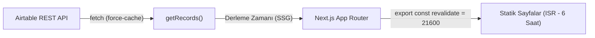

# Feyz.li

> Kafa açan içerikler için Airtable destekli statik web platformu.

Feyz.li, Airtable üzerinde tutulan kişisel veya kürasyon içeriklerini Next.js App Router mimarisiyle derleyip yüksek performanslı, SEO dostu statik sayfalar olarak sunar.

Mevcut Canlı Veri Tabanı: [Airtable Shared Base](https://airtable.com/shrTIyJJFloiJ7Vwv/tblyXzwQCAWZlbl05)

---

## İçindekiler

- [1. Eğitim: Hızlı Başlangıç (Tutorial)](#1-eğitim-hızlı-başlangıç-tutorial)
  - [1.1 Ön Koşullar](#11-ön-koşullar)
  - [1.2 Depoyu Klonlama ve Kurulum](#12-depoyu-klonlama-ve-kurulum)
  - [1.3 Airtable Tabanını Hazırlama](#13-airtable-tabanını-hazırlama)
  - [1.4 Ortam Değişkenlerini Tanımlama](#14-ortam-değişkenlerini-tanımlama)
  - [1.5 Geliştirme Sunucusunu Başlatma](#15-geliştirme-sunucusunu-başlatma)
- [2. Nasıl Yapılır? Kılavuzları (How-To Guides)](#2-nasıl-yapılır-kılavuzları-how-to-guides)
  - [2.1 Airtable Şablonunu İçe Aktarma](#21-airtable-şablonunu-içe-aktarma)
  - [2.2 Alıntı (Quote) Formatında İçerik Ekleme](#22-alıntı-quote-formatında-içerik-ekleme)
  - [2.3 Kapak Görseli Ekleme](#23-kapak-görseli-ekleme)
  - [2.4 Taslak İçerik Yönetimi](#24-taslak-içerik-yönetimi)
  - [2.5 Yeni Etiket Sayfaları ve Filtreleme](#25-yeni-etiket-sayfaları-ve-filtreleme)
  - [2.6 Vercel Üzerinde Dağıtım (Deployment)](#26-vercel-üzerinde-dağıtım-deployment)
  - [2.7 CLI Araçları ile Yönetim (Vercel & Airtable CLI)](#27-cli-araçları-ile-yönetim-vercel--airtable-cli)
  - [2.8 Tarayıcı Yer İmlerini (Bookmarks) İçe Aktarma](#28-tarayıcı-yer-imlerini-bookmarks-içe-aktarma)
- [3. Referans (Reference)](#3-referans-reference)
  - [3.1 Airtable Tablo Şeması](#31-airtable-tablo-şeması)
  - [3.2 Ortam Değişkenleri Referansı](#32-ortam-değişkenleri-referansı)
  - [3.3 Komut Referansı](#33-komut-referansı)
  - [3.4 TypeScript Arayüzleri](#34-typescript-arayüzleri)
  - [3.5 Rota ve Dizin Yapısı](#35-rota-ve-dizin-yapısı)
- [4. Mimari ve Açıklama (Explanation)](#4-mimari-ve-açıklama-explanation)
  - [4.1 Mimari Yaklaşım: Neden Airtable + Next.js?](#41-mimari-yaklaşım-neden-airtable--nextjs)
  - [4.2 Veri Akışı ve Önbellekleme Stratejisi](#42-veri-akışı-ve-önbellekleme-stratejisi)
  - [4.3 Statik Sayfa Üretimi (SSG) ve Sayfalama Algoritması](#43-statik-sayfa-üretimi-ssg-ve-sayfalama-algoritması)
  - [4.4 Güvenlik ve API Kotası Yönetimi](#44-güvenlik-ve-api-kotası-yönetimi)

---

## 1. Eğitim: Hızlı Başlangıç (Tutorial)

Bu eğitim, projeyi ilk defa çalıştıracak geliştiriciler için hazırlanmıştır. Adımları tamamladığınızda yerel ortamınızda Airtable verilerini çeken çalışan bir Next.js uygulamasına sahip olacaksınız.

### 1.1 Ön Koşullar

Başlamadan önce çalışma ortamınızda aşağıdakilerin kurulu olduğundan emin olun:

- **Node.js**: v20.x veya üzeri
- **npm**: v10.x veya üzeri
- **Git**
- **Airtable Hesabı** ve bir [Personal Access Token](https://airtable.com/create/tokens) (`data.records:read` iznine sahip olmalıdır)

### 1.2 Depoyu Klonlama ve Kurulum

Depoyu yerel makinenize klonlayın ve bağımlılıkları yükleyin:

```bash
git clone https://github.com/ademilter/feyz.git
cd feyz
npm install
```

> **Not:** Bu projede paket yöneticisi olarak `npm` kullanılır (`package-lock.json` kilit dosyasıdır).

### 1.3 Airtable Tabanını Hazırlama

1. Airtable paneline giriş yapın ve **Create a base** seçeneğiyle yeni bir çalışma alanı oluşturun.
2. Tabloyu oluşturmak için projenin kök dizinindeki [`airtable-template.csv`](./airtable-template.csv) dosyasını kullanın (**Add or import** > **CSV file**).
3. Tablo adını `content` olarak belirleyin.
4. Alan türlerini içe aktarım sihirbazında veya içe aktarım sonrasında [3.1 Airtable Tablo Şeması](#31-airtable-tablo-şeması) tablosuna uygun şekilde ayarlayın.

### 1.4 Ortam Değişkenlerini Tanımlama

Örnek çevre değişkenleri dosyasını `.env` olarak çoğaltın:

```bash
cp .env.example .env
```

`.env` dosyasını açıp Airtable erişim bilgilerinizi girin:

```env
AIRTABLE_API_KEY=pat_ornek_tokeniniz_buraya
AIRTABLE_BASE_ID=app_kendi_base_id_niz
AIRTABLE_TABLE_NAME=content
```

> Kendi base ID'nizi Airtable tablonuzun adres çubuğundaki URL'den (`https://airtable.com/appXXXXXXXXXXXXXX/...`) edinebilirsiniz.

### 1.5 Geliştirme Sunucusunu Başlatma

Yerel geliştirme sunucusunu çalıştırın:

```bash
npm run dev
```

Tarayıcınızda [http://localhost:3000](http://localhost:3000) adresini açın. Airtable tablonuzdaki `draft` değeri işaretli olmayan kayıtların başarıyla listelendiğini göreceksiniz.

---

## 2. Nasıl Yapılır? Kılavuzları (How-To Guides)

Belirli problemleri ve senaryoları çözmek için aşağıdaki kılavuzları uygulayabilirsiniz.

### 2.1 Airtable Şablonunu İçe Aktarma

Var olan bir Airtable base'ine Feyz şablonunu eklemek için:

1. Kök dizindeki [`airtable-template.csv`](./airtable-template.csv) dosyasını açın veya doğrudan Airtable'a yükleyin.
2. Sütunların veri türlerini şu şekilde yapılandırın:
   - `title`: Single line text
   - `url`: URL
   - `summary`: Long text
   - `source`: URL
   - `tags`: Multiple select
   - `createdDate`: Date (Time dahil: ISO 8601)
   - `image`: Attachment
   - `draft`: Checkbox
   - `author`: Single line text
3. Tablonuzun görünüm (view) adının `Grid view` olduğunu kontrol edin (`utils/airtable.ts` bu görünümü sorgular).

### 2.2 Alıntı (Quote) Formatında İçerik Ekleme

Büyük puntolu, özet metni içermeyen vurgulu bir söz/alıntı kartı oluşturmak için:

1. Yeni bir satır açın ve `title` alanına alıntıyı yazın.
2. `url` alanına söz konusu kaynağın bağlantısını verin.
3. `tags` alanına mutlaka `quote` etiketini ekleyin.
4. `summary` alanını boş bırakabilirsiniz.

Bileşen (`components/feyz.tsx`) `tags` dizisinde `quote` etiketini algıladığında kartı büyük tipografi ile biçimlendirir.

### 2.3 Kapak Görseli Ekleme

Bir içeriğe sağ tarafta görünecek küçük kapak görseli bağlamak için:

1. Airtable arayüzünde ilgili satırın `image` hücresine tıklayın.
2. Görsel dosyanızı sürükleyip bırakın (veya URL ile yükleyin).
3. CSV ile toplu aktarım yapıyorsanız, `image` sütununa doğrudan genel erişimli bir resim linki (örn. Unsplash URL'i) verin; Airtable dosyayı otomatik indirecektir.

Next.js `Image` bileşeni görseli otomatik optimize eder ve `v5.airtableusercontent.com` adresinden çeker.

### 2.4 Taslak İçerik Yönetimi

Bir içeriği hazırlayıp hemen yayına almamak için:

1. İlgili kaydın `draft` kutucuğunu işaretleyin (`true`).
2. API sorgusu `filterByFormula: draft=FALSE()` kuralını kullandığından bu kayıt Next.js tarafından derlenmez ve sitede görünmez.
3. İçeriği yayınlamak istediğinizde `draft` kutucuğundaki işareti kaldırmanız yeterlidir.

### 2.5 Yeni Etiket Sayfaları ve Filtreleme

Yeni bir kategoriyi filtre olarak sunmak için:

1. İçeriğin `tags` hücresine dilediğiniz etiketi yazın (örn: `Tasarım`, `Yapay Zeka`).
2. Derleme sırasında `generateStaticParams` tüm etiketleri toplar, tekilleştirir ve her biri için `/tag/[tag]` rotası üretir.
3. Sayfa üstündeki etiket navigasyon menüsü (`components/nav.tsx`) bu etiketleri otomatik olarak listeleyecektir.

### 2.6 Vercel Üzerinde Dağıtım (Deployment)

Feyz.li, Vercel platformuna özgü Incremental Static Regeneration (ISR) ve görsel optimizasyonu avantajlarını kullanır. Dağıtımı iki farklı yöntemle gerçekleştirebilirsiniz:

#### Yöntem A: GitHub Entegrasyonu ile Otomatik Dağıtım (Önerilen)

1. Kodlarınızı GitHub deponuza gönderin:
   ```bash
   git push origin main
   ```
2. [Vercel Dashboard](https://vercel.com/new)'a gidin ve **Import Git Repository** ile deponuzu seçin.
3. **Configure Project** ekranında **Environment Variables** bölümünü genişletin ve aşağıdaki anahtarları ekleyin:
   - `AIRTABLE_API_KEY`: Airtable Personal Access Token (Zorunlu)
   - `AIRTABLE_BASE_ID`: Airtable Base ID (Opsiyonel, varsayılan: `appeqvrnUnbvHVDmH`)
   - `AIRTABLE_TABLE_NAME`: Tablo adı (Opsiyonel, varsayılan: `content`)
4. **Deploy** butonuna tıklayın.

> [!IMPORTANT]
> Next.js derleme esnasında (`generateStaticParams` ve `getRecords`) Airtable'dan tüm içerikleri çektiği için, `AIRTABLE_API_KEY` Vercel'e eklenmeden başlatılan derlemeler hata verir.

#### Yöntem B: Vercel CLI ile Komut Satırından Dağıtım

Terminalden doğrudan dağıtım yapmak için:

```bash
# Projeyi Vercel hesabınıza bağlayın
npx vercel

# Çevre değişkenlerini Vercel projenize ekleyin
npx vercel env add AIRTABLE_API_KEY
npx vercel env add AIRTABLE_BASE_ID
npx vercel env add AIRTABLE_TABLE_NAME

# Üretim (Production) derlemesini başlatın
npx vercel --prod
```

#### İsteğe Bağlı: Airtable Değişikliklerinde Anında Dağıtım (Deploy Hook)

Airtable'da yeni bir içerik eklendiğinde 6 saatlik ISR döngüsünü beklemeden derlemeyi anında tetiklemek için:
1. Vercel projenizde **Settings** > **Git** > **Deploy Hooks** bölümüne gidin.
2. `airtable-publish` adıyla yeni bir hook oluşturup verilen URL'i kopyalayın.
3. Airtable tablonuzda **Automations** sekmesine gidin; bir içerik yayına alındığında (`draft = false`) bu webhook adresine `POST` isteği atan bir otomasyon kuralı tanımlayın.

### 2.7 CLI Araçları ile Yönetim (Vercel & Airtable CLI)

Terminal üzerinden hem dağıtım süreçlerini hem de Airtable içeriklerini yönetebilirsiniz.

#### Vercel CLI Pratik Kullanımı

Yerel geliştirme ile Vercel ortamını senkronize etmek için:

```bash
# Vercel hesabınıza giriş yapın
npx vercel login

# Mevcut depoyu Vercel projenizle ilişkilendirin
npx vercel link

# Vercel dashboard'undaki ortam değişkenlerini yerel .env.local dosyasına çekin
npx vercel env pull .env.local

# Yerel ortamda üretim benzeri önizleme derlemesi çalıştırın
npx vercel build

# Önizleme (Preview) ortamına dağıtın
npx vercel

# Canlı (Production) ortama dağıtın
npx vercel --prod
```

#### Airtable CLI ve cURL ile İçerik Yönetimi

Airtable web arayüzünü açmadan doğrudan terminalden içerik eklemek veya mevcut kayıtları listelemek için:

##### 1. `cURL` (Doğrudan REST API) ile:

```bash
# Kayıtları listeleme (Draft olmayanlar)
curl -s -H "Authorization: Bearer $AIRTABLE_API_KEY" \
  "https://api.airtable.com/v0/$AIRTABLE_BASE_ID/$AIRTABLE_TABLE_NAME?filterByFormula=draft=FALSE()"

# Terminalden yeni bir içerik ekleme
curl -X POST "https://api.airtable.com/v0/$AIRTABLE_BASE_ID/$AIRTABLE_TABLE_NAME" \
  -H "Authorization: Bearer $AIRTABLE_API_KEY" \
  -H "Content-Type: application/json" \
  -d '{
    "fields": {
      "title": "Terminalden Eklenen Yazı",
      "url": "https://example.com/terminal-post",
      "summary": "cURL kullanılarak doğrudan Airtable API üzerinden eklenmiştir.",
      "source": "https://example.com",
      "tags": ["Frontend", "CLI"],
      "createdDate": "'$(date -u +"%Y-%m-%dT%H:%M:%SZ")'",
      "draft": false
    }
  }'
```

##### 2. `airtable-cli` Paketi ile:

```bash
# airtable-cli ile hızlı kayıt ekleme
npx airtable-cli add \
  --api-key "$AIRTABLE_API_KEY" \
  --base "$AIRTABLE_BASE_ID" \
  --table "$AIRTABLE_TABLE_NAME" \
  title "Yeni Başlık" \
  url "https://example.com" \
  createdDate "$(date -u +"%Y-%m-%dT%H:%M:%SZ")"
```

### 2.8 Tarayıcı Yer İmlerini (Bookmarks) İçe Aktarma

Chrome, Safari, Firefox, Arc veya Edge gibi tarayıcılardan dışa aktardığınız HTML yer imi dosyasını tek komutla doğrudan Airtable tablonuza aktarabilirsiniz.

#### Yetkilendirme Notu

Yer imi aktarımı Airtable'a yeni kayıt eklediği ve güncellediği için, `AIRTABLE_API_KEY` belirtecinizin hem `data.records:read` hem de `data.records:write` yetkilerine sahip olması gerekir.

#### Öne Çıkan Özellikler

- **Klasör Filtresi (`--folder`):** Yalnızca belirlediğiniz klasördeki linkleri aktarır (örn: sadece `Feyz` veya `Okuma`).
- **Akıllı Birleştirme (Selective Upsert):** Aynı URL veritabanında zaten varsa önceki verilerinizi ezmez; **sadece boş olan alanları** (özet, kaynak, etiket vb.) tamamlar.
- **Tarih Filtresi (`--since`):** Belirli bir tarihten (`2024-01-01`) veya son X günden (`30d`) sonra eklenenleri seçer.
- **Alan Adı Filtresi (`--exclude`):** Sosyal medya, video veya arama portallarını hariç tutar.
- **Batch API Desteği:** Airtable API'sine 10'arlı paketler halinde göndererek kota (rate limit) aşımını engeller.
- **Simülasyon (`--dry-run`):** Veritabanına yazmadan nelerin ekleneceğini ve güncelleneceğini terminalde önizler.

#### Kullanım Örnekleri

```bash
# 1. bookmarks.html dosyasını simüle edin (Airtable'a hiçbir şey yazmaz)
npm run import:bookmarks -- --dry-run

# 2. Sadece "Feyz" klasöründeki yer imlerini aktarın
npm run import:bookmarks -- --folder="Feyz"

# 3. Özel bir dosyadan, ek etiketle ve youtube linklerini hariç tutarak aktarın
npm run import:bookmarks -- --file=yerimlerim.html --folder="Okuma" --tag="Teknoloji" --exclude=youtube.com

# 4. Son 30 günde eklenenleri taslak (draft=true) olarak aktarın
npm run import:bookmarks -- --since=30d --draft=true
```

---

## 3. Referans (Reference)

Projenin teknik veri modelleri, ortam değişkenleri ve komut tanımları.

### 3.1 Airtable Tablo Şeması

| Sütun Adı | Airtable Tipi | TS Tipi | Zorunlu? | Varsayılan / Örnek | Açıklama |
|---|---|---|---|---|---|
| `title` | Single line text | `string` | Evet | `"Tasarım Sistemleri Mimarisi"` | Kart başlığı ve slug kaynağı (Primary field) |
| `url` | URL | `string` | Evet | `"https://example.com/yazi"` | Tıklanınca açılacak asıl hedef bağlantı |
| `summary` | Long text | `string?` | Hayır | `"Ölçeklenebilir arayüzler..."` | Başlık altında gösterilen kısa açıklama |
| `source` | URL | `string?` | Hayır | `"https://example.com"` | Kaynak alan adı kartın altında ayrıştırılır (`hostname`) |
| `tags` | Multiple select | `string[]` | Evet | `["Frontend", "quote"]` | Etiketler. `quote` etiketi özel alıntı biçimini tetikler |
| `createdDate` | Date & Time | `string` | Evet | `"2026-01-15T10:00:00.000Z"` | ISO 8601 tarihi; azalan sıralama ve göreli zaman için |
| `image` | Attachment | `AirtableAttachment[]?` | Hayır | `[ { url: "..." } ]` | Kartın sağ tarafındaki kapak görseli |
| `draft` | Checkbox | `boolean?` | Hayır | `false` | `true` ise kayıt `draft=FALSE()` filtresine takılır |
| `author` | Single line text | `string?` | Hayır | `"ademilter"` | İçerik küratörü veya yazar adı |

### 3.2 Ortam Değişkenleri Referansı

| Değişken | Zorunlu? | Varsayılan | Açıklama |
|---|---|---|---|
| `AIRTABLE_API_KEY` | Evet | - | Airtable REST API erişim belirteci (Personal Access Token) |
| `AIRTABLE_BASE_ID` | Hayır | `appeqvrnUnbvHVDmH` | Hedef Airtable base kimliği |
| `AIRTABLE_TABLE_NAME` | Hayır | `content` | Sorgulanacak Airtable tablosu |

### 3.3 Komut Referansı

| Komut | Açıklama |
|---|---|
| `npm run dev` | Geliştirme sunucusunu yerel ortamda (`localhost:3000`) başlatır. |
| `npm run build` | Next.js üretim derlemesini çalıştırır ve statik sayfaları üretir. |
| `npm run start` | Derlenmiş üretim paketini yerel sunucuda çalıştırır. |
| `npm run lint` | ESLint kurallarını tüm proje dosyaları üzerinde denetler (`eslint .`). |
| `npm run format` | Prettier ile tüm kaynak kodları otomatik biçimlendirir. |
| `npm run format:check` | Kodların Prettier kurallarına uygunluğunu doğrular (dosya yazmaz). |
| `npm run import:bookmarks` | Tarayıcı HTML yer imi dosyasını Airtable'a filtreleyip aktarır. |

### 3.4 TypeScript Arayüzleri

Projenin Airtable veri tipleri [`types/airtable.ts`](./types/airtable.ts) içinde tanımlanmıştır:

```ts
export interface AirtableAttachment {
  id: string
  width: number
  height: number
  url: string
  filename?: string
  size?: number
  type?: string
  thumbnails?: {
    small?: { url: string; width: number; height: number }
    large?: { url: string; width: number; height: number }
    full?: { url: string; width: number; height: number }
  }
}

export interface AirtableRecord {
  id: string
  createdTime: string
  fields: {
    title: string
    url: string
    createdDate: string
    tags: string[]
    summary?: string
    source?: string
    draft?: boolean
    author?: string
    image?: AirtableAttachment[]
  }
}
```

### 3.5 Rota ve Dizin Yapısı

| Rota | Dosya | İşlev |
|---|---|---|
| `/` | `app/page.tsx` | Ana sayfa ilk sayfa içerikleri (`DATA_PER_PAGE = 10`) |
| `/[page]` | `app/[page]/page.tsx` | Ana sayfa sayfalanmış içerik listesi |
| `/tag/[tag]` | `app/tag/[tag]/page.tsx` | Belirli bir etikete ait ilk sayfa |
| `/tag/[tag]/[page]` | `app/tag/[tag]/[page]/page.tsx` | Belirli bir etikete ait sayfalanmış liste |
| `/feyz/[slug]` | `app/feyz/[slug]/page.tsx` | Tekil içerik detay / kalıcı bağlantı (permalink) sayfası |

---

## 4. Mimari ve Açıklama (Explanation)

Tasarım kararları, çalışma ilkeleri ve mimari mantık.

### 4.1 Mimari Yaklaşım: Neden Airtable + Next.js?

Geleneksel içerik yönetim sistemleri (CMS) ayrı bir veritabanı, yönetim paneli, kimlik doğrulama katmanı ve sunucu bakımı gerektirir. Feyz.li mimarisi bu maliyeti sıfıra indirmek üzere tasarlanmıştır:

- **Kullanıcı Arayüzü Olarak Airtable:** İçerik girişi, etiketleme, görsel yükleme ve taslak yönetimi doğrudan Airtable'ın hazır tablo arayüzünde yapılır. Veri girişi için ayrı bir CMS kodlamaya gerek kalmaz.
- **Yüksek Hız ve Güvenlik Olarak Next.js SSG:** İçerikler derleme sırasında statik HTML dosyalarına dönüştürülür. Ziyaretçi doğrudan CDN üzerinden statik dosya alır; veritabanı sorgusu gecikmesi veya sunucu yükü oluşmaz.

### 4.2 Veri Akışı ve Önbellekleme Stratejisi

Veri çekme mekanizması [`utils/airtable.ts`](./utils/airtable.ts) içerisindedir:



1. **`cache: 'force-cache'`:** Next.js veri çekme katmanında kullanılır. Derleme sırasında yinelenen API çağrıları engellenir ve yanıtlar yerel olarak önbelleğe alınır.
2. **`export const revalidate = 21600`:** Sayfa düzeyinde 6 saatlik (21.600 saniye) ISR (Incremental Static Regeneration) tanımlıdır. Airtable'a yeni içerik eklendiğinde sitenin tamamını yeniden derlemeye gerek kalmadan sayfalar arka planda periyodik olarak yenilenir.

### 4.3 Statik Sayfa Üretimi (SSG) ve Sayfalama Algoritması

Sitede dinamik sunucu render'ı (SSR) yerine tamamen statik dışa aktarım (SSG) kullanılır:

- `generateStaticParams`: Sayfalama (`[page]`) ve etiket (`tag/[tag]`) rotaları için derleme anında çalıştırılır.
- Toplam kayıt sayısı `DATA_PER_PAGE` (10) sabitine bölünerek kaç adet statik sayfa üretileceği hesaplanır (`utils/helper.ts` içindeki `pageFill`).
- Tüm benzersiz etiketler tek bir dizide toplanır ve her etiket için ayrı rota üretilir.

### 4.4 Güvenlik ve API Kotası Yönetimi

- **Anahtar Güvenliği:** `AIRTABLE_API_KEY` değişkeni `NEXT_PUBLIC_` ön eki taşımaz. Sadece sunucu tarafında (Node.js derleme ortamında) çalışır ve istemci bundle'ına kesinlikle dahil edilmez.
- **Kota Aşımını Önleme:** Airtable standart API'si saniyede 5 istek limiti uygular. Feyz.li, sayfaları derlerken `force-cache` kullanarak Airtable'a gönderilen istek sayısını minimize eder.
- **Özyinelemeli Sayfalama (Pagination Offset):** 100 kayıttan fazla veri olduğunda Airtable yanıtındaki `offset` parametresi takip edilerek tüm veri kümesi tek bir derleme akışında eksiksiz biçimde toplanır.
